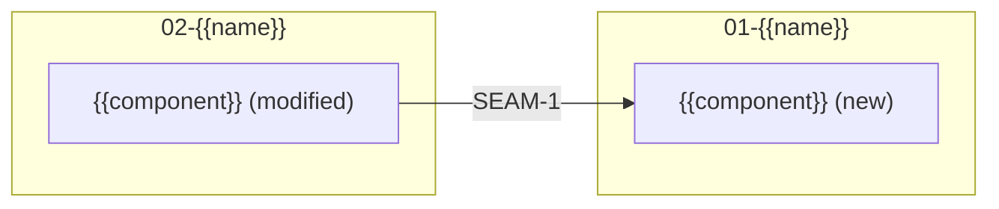

# {{Subject}} Overview

<!-- Remove template instructions and unused example entries from the completed overview. -->
<!-- One sentence in each table cell and each field. No sub-items. One diagram. Do not repeat the intent text. -->

- **Intent:** [intent.md](intent.md)
- **Outcome:** {{approved observable outcome}}

## Requirements

<!-- Include only selected requirements. Preserve supplied identifiers. -->
<!-- Slices: the slice numbers in delivery order. The last slice closes the requirement and uses this check. Leave the column empty until the Slices gate. -->

| ID | Requirement | Source | Check | Slices |
|---|---|---|---|---|
| FR-1 | The system must {{one checkable behavior}}. | {{intent, user, repository evidence, or inference}} | {{observable action and expected result}} | {{01, 03}} |
| NFR-1 | The system must {{measurable limit or binary condition}}. | {{source}} | {{observable action and expected result}} | {{03}} |

**Excluded and deferred:** {{None. Otherwise one line for each: identifier, proposal, excluded or deferred, decision, and consequence.}}

## Technology Stack

<!-- List only technology that this feature uses. Mark each entry existing or new. -->

- **{{language, framework, runtime, data store, or library}}** {{version}} — {{existing or new}}; {{use in this feature}}. Evidence: {{manifest or lock file, or source URL}}. Slices: {{slice numbers}}.

## Whole flow

<!-- Before the Slices gate: one subgraph per architecture layer. After it: one subgraph per slice, and a seam identifier on each arrow that crosses a slice boundary. -->
<!-- Mark each component unchanged, modified, new, or removed. -->



<!-- Numbered steps from the trigger to the observable outcome. Add the slice identifier at the Slices gate. -->

1. {{Trigger and the component that receives it.}} (`{{NN-name}}`)
2. {{Next action and the component that does it.}} (`{{NN-name}}`)
3. {{Observable outcome.}} (`{{NN-name}}`)

### Decisions

<!-- Only decisions that affect more than one layer. -->

- **{{decision}}** — {{source and reason}}. {{Strongest realistic alternative and its trade-off; omit when unnecessary.}}

## Slices

<!-- Rows are in delivery order. Each slice depends only on earlier slices. One slice is a valid result. -->

| Slice | Layer | Goal | Depends on | Done when |
|---|---|---|---|---|
| [01-{{name}}](slices/01-{{name}}/slice.md) | {{one layer, or merged adjacent layers}} | {{what exists after this slice}} | {{slice identifiers or none}} | {{check that passes without a later slice}} |

## Seam contracts

<!-- One entry for each interface that crosses a slice boundary. Write "None" when the feature has one slice. -->
<!-- The overview owns each entry. Slice files hold copies without change. -->

### `SEAM-1` — {{name}}

- **Kind:** {{type, function, HTTP endpoint, table, event, or file format}}
- **Provider:** `{{NN-name}}`
- **Consumers:** `{{NN-name}}`, `{{NN-name}}`
- **Shape:** {{existing `file:symbol`, or the block below with 15 lines at most}}

  ```{{lang}}
  {{names, types, and errors that a consumer can observe}}
  ```

- **Rules:** {{invariants that a consumer can rely on, and compatibility with existing consumers}}

## Approval Records

<!-- Record actual approval evidence. A heading or completed section is not approval. -->
<!-- Mark a record superseded when its decision changes. Keep unaffected records. -->

- **Scope** — {{included requirements, exclusions, and deferrals}}
  - Evidence: {{user approval statement and date}}
  - Validity: {{current or superseded, with reason}}
- **HLD** — {{Technology Stack, whole flow, and decisions}}
  - Evidence: {{user approval statement and date}}
  - Validity: {{current or superseded, with reason}}
- **Slices** — {{slice list in delivery order, seam contracts, and requirement allocation}}
  - Evidence: {{user approval statement and date}}
  - Validity: {{current or superseded, with reason}}
